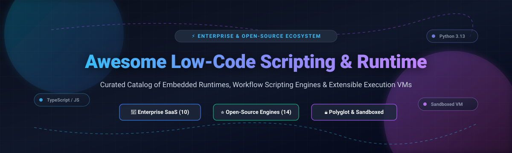

# ⚡ Awesome Low-Code Scripting Language & Runtime 🚀

 
 

  

> **A curated, comprehensive catalog of enterprise-grade SaaS and cutting-edge Open-Source Low-Code Scripting Languages, embeddable execution runtimes, workflow automation engines, and sandboxed developer VMs for extending applications without full rebuilds.**

---

## 📑 Table of Contents

- [🌐 Sector Overview & Market Dynamics](#-sector-overview--market-dynamics)
- [🟦 SaaS / Hosted Platforms](#-saas--hosted-platforms)
  - [🏢 Enterprise SaaS Comparison Table](#-enterprise-saas-comparison-table)
  - [🔍 Detailed SaaS Profiles](#-detailed-saas-profiles)
- [🟩 Open-Source Software](#-open-source-software)
  - [⭐ Open-Source Engines & Runtimes Table](#-open-source-engines--runtimes-table)
  - [🛠️ Detailed Open-Source Profiles](#-detailed-open-source-profiles)
- [📊 Feature Comparison at a Glance](#-feature-comparison-at-a-glance)
- [📈 Star History](#-star-history)
- [💖 Support](#-support)
- [🤝 Contributing](#-contributing)
- [📄 License](#-license)

---

## 🌐 Sector Overview & Market Dynamics

The global low-code development platform (LCDP) market reached an estimated **$40–$44+ billion** in the 2024–2026 window and is on trajectory to surpass **$58.2 billion by 2029**, progressing at a robust Compound Annual Growth Rate (**CAGR of ~14.1%**). Gartner projects that citizen developers and enterprise teams now account for over **65% of net-new application development activity**, driving demand for embedded scripting engines that enable non-developers and specialized engineers to inject dynamic business logic into operational platforms without enduring monolithic deployment cycles.

The sector is **highly to moderately fragmented and intensely competitive** rather than a winner-take-all monopoly. While mega-cap platform giants (Alphabet, Salesforce, ServiceNow) dominate proprietary vertical ecosystems with native enterprise runtimes like Apex, Apps Script, and ServiceNow Custom Actions, a fast-growing wave of independent low-code workflow orchestrators (Zapier, Workato, Make, Retool) and self-hostable open-source polyglot runtimes (n8n, ToolJet, Appsmith, Windmill, CEL) compete vigorously on extensibility, cost transparency, and sandbox security.

---

## 🟦 SaaS / Hosted Platforms

Enterprise-grade, cloud-hosted Low-Code Scripting Language and Runtime platforms. The comparative table below benchmarks market scale (valuation / annual revenue), entry-level commercial pricing tiers, and precise free tier or trial limitations.

### 🏢 Enterprise SaaS Comparison Table

> *Sorted by company scale (valuation / annual revenue) in descending order.*

| 🏢 Platform | 💰 Company Scale (Valuation / ARR) | 💵 Starting Tier Pricing | 🎁 Free Tier / Trial Limit | 🎯 Core Focus |
|:---|:---|:---|:---|:---|
| **[Google Apps Script](https://developers.google.com/apps-script)** | **~$3.5T Market Cap** (~$350B+ Rev) | **$7/user/month** (Google Workspace Starter) | **Free Forever**: 6-min runtime/exec, 90 min/day total triggers, 100 email recipients/day with standard consumer Google account | Cloud-native JavaScript runtime automating Google Workspace apps |
| **[Salesforce Apex](https://developer.salesforce.com/docs/atlas.en-us.apexcode.meta/apexcode/apex_intro.htm)** | **~$190B Market Cap** (~$38B+ Rev) | **$25/user/month** (Starter Suite, billed annually) | **30-Day Free Trial**: Full CRM suite, up to 10 users, 2,000 marketing emails/mo, no credit card required | Strongly-typed, object-oriented multitenant execution engine on Salesforce servers |
| **[ServiceNow Flow Scripts](https://docs.servicenow.com/)** | **~$105B Market Cap** (~$11B+ Rev) | **Custom Quote** (Enterprise agreements typically start at ~$10,000/year) | **Free Forever Developer Instance (PDI)**: Full platform dev sandbox for testing, auto-hibernates after inactivity | Server-side JavaScript scripting within Flow Designer Custom Actions |
| **[Zoho Deluge](https://www.zoho.com/deluge/)** | **~$12.5B Valuation** (~$1.5B Rev) | **$14/user/month** (Zoho CRM Standard, billed annually) | **Free Forever Edition**: Up to 3 users, 5,000 records, 250 API calls/day (Zoho Creator / CRM) | Domain-specific, dynamically typed embedded workflow language across Zoho products |
| **[Make Custom Functions](https://www.make.com/)** | **~$13B (Celonis Parent)** (~$100M ARR) | **$9/month** (Core Plan billed annually, 10,000 ops) | **Free Forever Plan**: 1,000 operations/month, 2 active scenarios, 15-minute minimum execution interval | Visual scenario orchestration with enterprise reusable data transformation functions |
| **[Workato Recipes](https://www.workato.com/)** | **~$5.7B Valuation** (~$150M+ Rev) | **$75/month** (Self-service starter credit ladder) | **14-Day Free Trial**: Sandbox trial with one-time test recipe credits; production workspaces custom-quoted | Enterprise integration & automation recipes with API endpoints and LLM Copilot |
| **[Zapier Code](https://zapier.com/)** | **~$5.0B Valuation** (~$310M ARR) | **$19.99/month** (Professional Plan, billed annually) | **Free Forever Plan**: 100 tasks/month, 2-step Zaps, single-threaded code steps capped at 1s runtime & 512MB RAM | Inline JavaScript (Node.js 22) and Python 3.13 steps within automated multi-app Zaps |
| **[Retool JavaScript Runtime](https://retool.com/)** | **~$3.2B Valuation** (~$120M ARR) | **$10/user/month** (Team Plan, billed annually) | **Free Forever Plan**: Up to 5 users, unlimited apps, 500 workflow runs/month, 5 GB database storage | Drag-and-drop internal app builder with full client & server JS code transformation blocks |
| **[Quickbase Pipelines](https://www.quickbase.com/)** | **~$1.0B Valuation** (~$200M Rev) | **$8,500/year** (Team Plan annual minimum commitment) | **30-Day Free Trial**: Complete feature access, sandbox pipelines, up to 10 users, no credit card required | Operational workflow pipelines utilizing Jinja templating expressions for data logic |
| **[Appsmith JS Objects](https://www.appsmith.com/)** | **~$260M Valuation** (~$51.5M Raised) | **$15/user/month** (Business Cloud Tier) | **Free Forever Plan**: Up to 5 users on Cloud (Unlimited users for Community Self-Hosted), 5 workspaces, 3 Git repos | Reactive JavaScript objects and bindings connected directly to REST/GraphQL APIs and SQL databases |

---

### 🔍 Detailed SaaS Profiles

#### ⚡ [Google Apps Script](https://developers.google.com/apps-script)
* **Type:** Cloud-native JavaScript runtime for Google Workspace automation
* **Key Capabilities:**
  - Modern ECMAScript JavaScript runtime hosted directly on Google cloud infrastructure without local server provisioning.
  - Native integration with Google Drive, Gmail, Docs, Sheets, Slides, Calendar, and Forms.
  - Exposes HTML Service for developing custom dialogs, sidebars, and full-fledged web applications.
  - Enforces quota limits: 6 minutes execution runtime per script, 90 minutes/day total trigger runtime on consumer accounts.
* **Best for:** Teams deeply embedded in the Google Workspace ecosystem looking to automate repetitive data hygiene and reporting workflows.

#### ⚡ [Salesforce Apex](https://developer.salesforce.com/docs/atlas.en-us.apexcode.meta/apexcode/apex_intro.htm)
* **Type:** Strongly typed, multitenant object-oriented programming language
* **Key Capabilities:**
  - Java-like syntax executing natively on Salesforce application servers alongside Lightning components and Visualforce pages.
  - Multitenant-aware runtime with automated governor limits guarding database queries (SOQL/SOSL) and heap allocations.
  - Built-in transaction management, atomic DML operations, rollback controls, and automated unit test suite verification.
* **Best for:** Enterprise Salesforce architects needing resilient, mission-critical server-side transactional business logic.

#### ⚡ [ServiceNow Flow Designer Scripts](https://docs.servicenow.com/)
* **Type:** Enterprise server-side script steps inside Flow Designer Custom Actions
* **Key Capabilities:**
  - Encapsulated reusable script steps (JavaScript) packaged cleanly inside Flow Designer Actions.
  - Access to standard ServiceNow Glide APIs (`GlideRecord`, `GlideSystem`) without altering base low-code flows.
  - Role-based governance separating citizen-developer workflow design from hardened backend script libraries.
* **Best for:** Enterprise IT service management (ITSM) and automated incident resolution workflows requiring custom API logic.

#### ⚡ [Zoho Deluge](https://www.zoho.com/deluge/)
* **Type:** Proprietary domain-specific scripting language across Zoho suite
* **Key Capabilities:**
  - Dynamic type system with built-in primitives for CRM records, relational lists, date-time, and files.
  - Pre-built wrappers (`zoho.crm.getRecord`, `zoho.crm.searchRecords`, `invokeurl`) avoiding tedious HTTP headers and OAuth token handshakes.
  - Comprehensive error interception with `try-catch`, `throw`, and dedicated live console `info` debug statements.
* **Best for:** Businesses standardizing sales, billing, and operational automation across Zoho CRM and Zoho Creator.

#### ⚡ [Make Custom Functions](https://www.make.com/)
* **Type:** Reusable logic and data-transformation functions within Make scenarios
* **Key Capabilities:**
  - Allows technical engineers to compose custom calculation and formatting routines testable in an isolated debugger.
  - Non-technical builders drag-and-drop custom functions as intuitive formula tokens inside visual scenario pipelines.
  - Handles sophisticated edge cases like multi-timezone business calendar offsets, UTM payload extractions, and tax calculations.
* **Best for:** High-volume visual automation teams needing centralized business logic formulas shared across scenarios.

#### ⚡ [Workato Recipes](https://www.workato.com/)
* **Type:** Enterprise integration recipes with conditional triggers, actions, and code steps
* **Key Capabilities:**
  - Visual enterprise workflow orchestration with conditional branching, repeat loops, and transactional rollbacks.
  - Recipe Copilot integration using generative models to translate natural language objectives into workflow steps.
  - Multi-pattern automation support: Workflow recipes, synchronous API recipes, and high-throughput data pipeline ETL recipes.
* **Best for:** Global enterprises interconnecting complex ERPs (SAP, NetSuite), CRMs, and HRIS systems with AI-guided assistance.

#### ⚡ [Zapier Code](https://zapier.com/)
* **Type:** Sandboxed JavaScript (Node.js 22) and Python (3.13) code steps in Zaps
* **Key Capabilities:**
  - Executes isolated code snippets directly in cloud compute workers to manipulate payloads between third-party SaaS apps.
  - External package import support from npm and PyPI on paid tiers using the native Zapier SDK.
  - Scalable runtime execution: 1 second on Free tier, up to 30 seconds on Professional, and 2 to 10 minutes on Enterprise.
* **Best for:** Citizen developers and integration specialists overcoming native connector constraints with lightweight scripts.

#### ⚡ [Retool JavaScript Runtime](https://retool.com/)
* **Type:** Full-featured client and server JavaScript execution environment for internal apps
* **Key Capabilities:**
  - Write inline JavaScript anywhere wrapped in `{{ }}` double-curly syntax with instant reactive UI evaluation.
  - Pre-bundled utility libraries: Lodash, Moment.js, Numbro, PapaParse, UUID, plus custom npm package imports.
  - Retool Workflows engine for orchestrating scheduled cron jobs, background webhook listeners, and complex DAG executions.
* **Best for:** Engineering teams building custom internal admin tools, customer support portals, and database dashboards.

#### ⚡ [Quickbase Pipelines (Jinja)](https://www.quickbase.com/)
* **Type:** Jinja templating language integration for Pipeline data transformation
* **Key Capabilities:**
  - Write Jinja expressions for dynamic string manipulation, arithmetic, boolean conditions, and timestamp calculations.
  - Intercepts and transforms up to 100 records in-memory during search and query pipeline steps without script servers.
  - Loop step abstraction for processing larger enterprise data sets past Jinja's memory-safe bounds.
* **Best for:** Operations teams building agile database applications and automated notifications in Quickbase.

#### ⚡ [Appsmith JS Objects](https://www.appsmith.com/)
* **Type:** Modular JavaScript objects with automatic dependency tracking and reactive execution
* **Key Capabilities:**
  - Encapsulate reusable JavaScript utility functions, helper methods, and async API calls inside structured JS Objects.
  - Three execution modes: Manual invocation, On Page Load execution, or Automatic reactive re-triggering upon dependency changes.
  - Full Git integration supporting pull requests, branch protection, and multi-environment deployment pipelines.
* **Best for:** Developers who want an open, code-friendly internal tool builder that behaves like standard React state management.

---

## 🟩 Open-Source Software

Self-hosted, community-driven Low-Code Scripting Languages, polyglot execution engines, and embeddable runtime VMs. The table below is sorted by **GitHub Star Count (descending)** with direct links to each project's stargazers page.

### ⭐ Open-Source Engines & Runtimes Table

> *Sorted by GitHub Star Count in descending order.*

| 🛠️ Software | ⭐ Star Count | 📜 License | 💻 Primary Stack | 🎯 Core Architecture & Highlights |
|:---|:---:|:---|:---|:---|
| **[n8n](https://github.com/n8n-io/n8n)** |  | Sustainable (Fair-code) | TypeScript / Node.js | Fair-code workflow automation with native visual node editor and full inline JavaScript/Python code nodes |
| **[Flowise](https://github.com/FlowiseAI/Flowise)** |  | MIT | TypeScript / React | Drag-and-drop visual canvas to build customized LLM orchestration apps, agents, and custom function runners |
| **[Huginn](https://github.com/huginn/huginn)** |  | MIT | Ruby / Rails | Open-source system for building automated agents that scan websites, parse data, and run event-driven tasks |
| **[Appsmith](https://github.com/appsmithorg/appsmith)** |  | Apache-2.0 | Java / TypeScript | Enterprise internal tool builder with reactive JavaScript objects, SQL/REST integrations, and Git sync |
| **[ToolJet](https://github.com/ToolJet/ToolJet)** |  | AGPL-3.0 | TypeScript / NestJS | Open-source low-code framework to build internal tools and apps with custom JS queries and Python runners |
| **[Hasura GraphQL Engine](https://github.com/hasura/graphql-engine)** |  | Apache-2.0 | Haskell / Go | Instant realtime GraphQL/REST APIs over databases with fine-grained access control and event-driven webhooks |
| **[Activepieces](https://github.com/activepieces/activepieces)** |  | MIT | TypeScript | Open-source, self-hostable Zapier alternative with 400+ connectors, AI agent orchestration, and code steps |
| **[Node-RED](https://github.com/node-red/node-red)** |  | Apache-2.0 | JavaScript / Node.js | Low-code event-driven visual wiring tool for hardware devices, IoT sensors, APIs, and online cloud services |
| **[Parse Server](https://github.com/parse-community/parse-server)** |  | BSD-3-Clause | Node.js / JavaScript | Open-source backend runtime with Cloud Code JavaScript functions, live queries, and automated database APIs |
| **[Windmill](https://github.com/windmill-labs/windmill)** |  | AGPL-3.0 / Apache-2.0 | Rust / TypeScript / Python | Ultra-fast developer platform turning scripts (TS, Python, Go, Bash, SQL) into auto-generated UIs, APIs & DAGs |
| **[ILLA Cloud Builder](https://github.com/illacloud/illa-builder)** |  | Apache-2.0 | Go / TypeScript | Low-code internal tool suite supporting drag-and-drop components, custom JS transformations, and workflow queues |
| **[Expr](https://github.com/expr-lang/expr)** |  | MIT | Go | High-performance, memory-safe, embeddable expression evaluation engine for Go applications and rule engines |
| **[Flask-AppBuilder](https://github.com/dpgaspar/Flask-AppBuilder)** |  | BSD-3-Clause | Python | Rapid web application development framework with auto CRUD generation, declarative security, and UI builders |
| **[CEL (Common Expression Language)](https://github.com/google/cel-spec)** |  | Apache-2.0 | C++ / Go / Spec | Non-Turing complete, memory-safe embeddable expression language designed by Google for policy evaluation |
| **[Starlark in Go](https://github.com/google/starlark-go)** |  | BSD-3-Clause | Go | Hermetic, deterministic Python-dialect configuration and scripting language for application customization |
| **[ByteChef](https://github.com/bytechefhq/bytechef)** |  | Apache-2.0 | Java / TypeScript | Embeddable integration engine and workflow builder with 270+ connectors, AI agents, and multi-language code steps |
| **[D4rt](https://github.com/kodjodevf/d4rt)** |  | MIT | Dart | Embeddable sandboxed Dart interpreter and runtime engine for executing dynamic code safely in Flutter apps |
| **[NoctLang](https://github.com/awemorris/NoctLang)** |  | zlib | C89 / Assembly | Ultra-lightweight embeddable scripting language with JIT/AOT compilers, generational GC, and tiny memory footprint |
| **[Weblang](https://github.com/eldoy/weblang)** |  | MIT | JavaScript / YAML | Safe, JSON-compatible, YAML-syntax low-code scripting language with sandboxed file/network boundaries |

---

### 🛠️ Detailed Open-Source Profiles

#### ⚡ [n8n](https://github.com/n8n-io/n8n)
* **Stack:** TypeScript / Node.js · **License:** Sustainable (Fair-code)
* **Key Features:**
  - Fair-code visual automation system with 400+ native connectors to popular cloud tools and databases.
  - Write custom JavaScript or Python code steps directly within any node for advanced transformations.
  - Native LangChain integration allowing users to design self-healing AI agents, vector stores, and custom tools visually.
* **Best for:** Developers needing a robust self-hosted workflow automation hub that pairs visual drag-and-drop with full code flexibility.

#### ⚡ [Flowise](https://github.com/FlowiseAI/Flowise)
* **Stack:** TypeScript / React · **License:** MIT
* **Key Features:**
  - Low-code UI canvas designed specifically for assembling LangChain, LlamaIndex, and autonomous AI agents.
  - Custom function execution nodes allowing inline JavaScript execution for payload normalization.
  - Instant REST API endpoint generation for embedding AI pipelines into production web applications.
* **Best for:** AI engineers and developers rapidly building LLM chains, agentic swarms, and retrieval-augmented generation (RAG) apps.

#### ⚡ [Huginn](https://github.com/huginn/huginn)
* **Stack:** Ruby / Rails · **License:** MIT
* **Key Features:**
  - Battle-tested event-driven agent system that monitors APIs, scrapes websites, and executes automated conditional logic.
  - JavaScript-evaluating agent nodes for parsing messy web DOM trees and formatting payloads.
  - Completely private and self-hosted with no external telemetry or vendor lock-in.
* **Best for:** Privacy-conscious engineers wanting a self-hosted "IFTTT" for web scraping and automated event processing.

#### ⚡ [Appsmith](https://github.com/appsmithorg/appsmith)
* **Stack:** Java / TypeScript · **License:** Apache-2.0
* **Key Features:**
  - Rapid UI builder connecting directly to PostgreSQL, MongoDB, Snowflake, REST APIs, and GraphQL endpoints.
  - JavaScript Objects (JS Objects) for clean separation of UI components from reactive business logic.
  - Built-in Git version control enabling multi-developer collaboration, feature branches, and CI/CD promotion.
* **Best for:** Engineering teams building custom internal back-office applications, customer support portals, and CRUD dashboards.

#### ⚡ [ToolJet](https://github.com/ToolJet/ToolJet)
* **Stack:** TypeScript / NestJS · **License:** AGPL-3.0
* **Key Features:**
  - Open-source low-code platform with 50+ built-in UI components and pre-configured connectors to 40+ data sources.
  - Run JavaScript queries and custom Python code in sandboxed workers to mutate and clean data payloads.
  - AI App Generation capabilities that build functional application interfaces directly from prompts or MCP servers.
* **Best for:** Full-stack developers seeking an extensible open-source alternative to Retool for internal enterprise tooling.

#### ⚡ [Hasura GraphQL Engine](https://github.com/hasura/graphql-engine)
* **Stack:** Haskell / Go · **License:** Apache-2.0
* **Key Features:**
  - Instantly generates low-latency, real-time GraphQL and REST APIs on PostgreSQL, MySQL, SQL Server, and BigQuery.
  - Event Triggers and Actions that call serverless webhooks and custom microservices whenever database rows change.
  - Granular role-based authorization system evaluating row-level and column-level permission rules at runtime.
* **Best for:** Teams building dynamic data backends with declarative permissions and automated webhook pipelines.

#### ⚡ [Activepieces](https://github.com/activepieces/activepieces)
* **Stack:** TypeScript · **License:** MIT
* **Key Features:**
  - Ultra-clean, modern visual automation platform with over 400 community-contributed integration pieces.
  - Inline TypeScript code steps executed in sandboxed workers for custom transformation rules.
  - First-class support for MCP (Model Context Protocol) servers and autonomous AI workflow workers.
* **Best for:** Organizations needing a clean, lightweight, fully open-source (MIT) alternative to Zapier and Make.

#### ⚡ [Node-RED](https://github.com/node-red/node-red)
* **Stack:** JavaScript / Node.js · **License:** Apache-2.0
* **Key Features:**
  - Flow-based visual programming environment built originally by IBM for IoT, telemetry, and edge-device automation.
  - Custom JavaScript function nodes executing within the Node.js V8 runtime with access to global state buffers.
  - Thriving ecosystem of over 4,000 community nodes spanning serial ports, MQTT, WebSockets, and REST APIs.
* **Best for:** IoT developers, industrial automation engineers, and edge gateways processing event streams.

#### ⚡ [Parse Server](https://github.com/parse-community/parse-server)
* **Stack:** Node.js / JavaScript · **License:** BSD-3-Clause
* **Key Features:**
  - Modular, open-source backend framework delivering automated database persistence, file storage, and user authentication.
  - Cloud Code runtime environment for deploying server-side JavaScript functions, before/after save database hooks, and jobs.
  - LiveQuery real-time pub/sub subscriptions for synchronization across web and mobile clients.
* **Best for:** Mobile and web application developers needing an open-source, self-hosted alternative to Firebase.

#### ⚡ [Windmill](https://github.com/windmill-labs/windmill)
* **Stack:** Rust / TypeScript / Python / Go · **License:** AGPL-3.0 / Apache-2.0
* **Key Features:**
  - Code-first developer runtime: Write scripts in TypeScript, Python, Go, Bash, or SQL; Windmill auto-generates UI forms and REST endpoints.
  - Blazing-fast Rust-based orchestrator with sub-millisecond execution overhead, significantly faster than Airflow or Temporal.
  - Low-code App Builder and Flow Builder for composing scripts into complex Directed Acyclic Graphs (DAGs) with retries.
* **Best for:** Developers who despise visual workflow limitations and demand a script-first platform with enterprise execution speed.

#### ⚡ [Expr](https://github.com/expr-lang/expr)
* **Stack:** Go · **License:** MIT
* **Key Features:**
  - High-performance, memory-safe, embeddable expression evaluation engine for Go applications.
  - Compiles expressions to bytecode that executes on an internal virtual machine faster than native reflection.
  - Type-safe execution with custom functions, struct navigation, array filters, and zero external runtime dependencies.
* **Best for:** Go developers needing an embedded expression runtime for dynamic business rule engines and pricing calculations.

#### ⚡ [CEL (Common Expression Language)](https://github.com/google/cel-spec)
* **Stack:** C++ / Go / Spec · **License:** Apache-2.0
* **Key Features:**
  - Fast, portable, non-Turing complete expression language designed by Google for policy validation and data filtering.
  - Guaranteed termination with predictable linear runtime complexity, making it immune to infinite loop attacks.
  - Adopted widely by Kubernetes (Admission Control), Envoy Proxy, Google Cloud IAM, and Firebase Rules.
* **Best for:** Systems architects requiring a mathematically safe, embeddable policy evaluation runtime for untrusted user inputs.

#### ⚡ [Starlark in Go](https://github.com/google/starlark-go)
* **Stack:** Go · **License:** BSD-3-Clause
* **Key Features:**
  - Dialect of Python developed for Bazel to configure build targets deterministically and hermetically.
  - Disables recursion, infinite loops, and ambient I/O (no file system, clock, or network access by default).
  - Parallel execution safe: Multiple Starlark threads can evaluate shared data structures concurrently without locks.
* **Best for:** Applications requiring safe, deterministic Pythonic scripting configuration without arbitrary code execution risks.

#### ⚡ [ByteChef](https://github.com/bytechefhq/bytechef)
* **Stack:** Java / TypeScript · **License:** Apache-2.0
* **Key Features:**
  - Embeddable integration engine designed to be embedded directly into multi-tenant SaaS products.
  - Visual flow builder coupled with polyglot code execution steps in JavaScript, Python, or Java.
  - AI agents as first-class workflow steps with memory stores, guardrails, and human-in-the-loop review approvals.
* **Best for:** SaaS engineering teams needing to provide customer-facing integration workflows and embedded automations.

---

## 📊 Feature Comparison at a Glance

| Software | Model | Stack | Embeddable | Visual Canvas | Sandboxed Execution | Self-Hostable | Primary Use Case |
|:---|:---|:---|:---:|:---:|:---:|:---:|:---|
| **Google Apps Script** | SaaS | JavaScript | ❌ | ❌ (IDE) | ✅ Quota-based | ❌ | Workspace office automation |
| **Salesforce Apex** | SaaS | Apex (Java-like) | ❌ | ❌ (IDE) | ✅ Multitenant | ❌ | CRM business logic |
| **ServiceNow Scripts** | SaaS | JavaScript | ❌ | ✅ Actions | ✅ Platform rules | ❌ | Enterprise ITSM flows |
| **Zoho Deluge** | SaaS | Deluge | ❌ | ✅ Builder | ✅ Quota-based | ❌ | Zoho app suite automation |
| **Make Functions** | SaaS | Formulas/JS | ❌ | ✅ Canvas | ✅ Cloud VM | ❌ | iPaaS scenario transformations |
| **Workato Recipes** | SaaS | Ruby/JS/AI | ❌ | ✅ Flow | ✅ Cloud VM | ❌ | Enterprise iPaaS orchestration |
| **Zapier Code** | SaaS | Node.js / Python | ❌ | ✅ Step-based | ✅ 512MB Worker | ❌ | Multi-app integration glue |
| **Retool JS** | SaaS / Hybrid | JavaScript | ❌ | ✅ Drag-drop | ✅ Browser/Worker | ✅ (Self-hosted) | Internal business tools |
| **Appsmith JS** | SaaS / Hybrid | JavaScript | ❌ | ✅ Drag-drop | ✅ Sandbox | ✅ | Reactive admin portals |
| **Quickbase Pipelines**| SaaS | Jinja | ❌ | ✅ Step-based | ✅ 100-rec buffer | ❌ | Low-code database workflows |
| **n8n** | Open-Source | TypeScript/Python | ✅ (API) | ✅ Node canvas | ✅ Node VM | ✅ | Visual workflow automation |
| **Flowise** | Open-Source | TypeScript/React | ✅ (SDK) | ✅ Node canvas | ✅ Worker VM | ✅ | AI agent & LLM orchestration |
| **Huginn** | Open-Source | Ruby/JS | ❌ | ✅ Graph | ✅ Agent sandbox | ✅ | Data monitoring & scraping |
| **ToolJet** | Open-Source | TS / Python | ✅ | ✅ Drag-drop | ✅ Sandboxed query | ✅ | Open-source internal tools |
| **Hasura Engine** | Open-Source | Haskell/Go | ✅ (API) | ✅ Schema UI | ✅ Role-based | ✅ | Instant data APIs & triggers |
| **Activepieces** | Open-Source | TypeScript | ✅ | ✅ Step canvas | ✅ Sandboxed VM | ✅ | MIT workflow automation |
| **Node-RED** | Open-Source | JavaScript | ✅ | ✅ Node wiring | ✅ Node VM | ✅ | IoT event-driven wiring |
| **Parse Server** | Open-Source | JavaScript | ✅ | ❌ (Backend) | ✅ Cloud Code VM | ✅ | Application backend & jobs |
| **Windmill** | Open-Source | Rust/Python/TS | ✅ (SDK) | ✅ Flow + Apps | ✅ Isolated worker | ✅ | Script-first high-speed DAGs |
| **Expr** | Open-Source | Go | ✅ Embedded | ❌ (Code) | ✅ Memory-safe | ✅ | Business rule calculation |
| **Google CEL** | Open-Source | C++ / Go | ✅ Embedded | ❌ (Code) | ✅ Guaranteed stop | ✅ | Policy & auth expression evaluation |
| **Starlark in Go** | Open-Source | Go | ✅ Embedded | ❌ (Code) | ✅ Hermetic sandbox | ✅ | Deterministic configuration |
| **ByteChef** | Open-Source | Java/TS/Python | ✅ Embedded | ✅ Step canvas | ✅ Sandboxed steps | ✅ | Embedded SaaS integration |

---

## 📈 Star History

---

## 💖 Support

If you find this curated collection valuable for discovering low-code scripting languages and accelerating your application runtime architecture:

- ⭐ **Star this repository** on GitHub to keep it visible to fellow engineers and developers!
- 🍴 **Fork the repository** to contribute new platforms, runtimes, benchmarks, or tool profiles.
- 📢 **Share this list** with your engineering team, technical architects, and developer communities.
- ☕ **Sponsor & Buy me a coffee**: If you would like to support ongoing maintenance, research, and curation across our awesome lists, please consider sponsoring via the **[GitHub Sponsors Dashboard](https://github.com/sponsors/ishandutta2007)**!

Thank you for being part of the open-source developer tooling community! 🚀

---

## 🤝 Contributing

Contributions, feature suggestions, and tool additions are warmly welcomed!

If you know of an outstanding open-source or commercial low-code scripting language or runtime that belongs here:
1. Review the existing categories, table formats, and quality guidelines.
2. Ensure open-source submissions are active and actively maintained (releases or commits within the last 12 months).
3. Submit a Pull Request detailing the project name, repository/website URL, tech stack, license, and what makes it exceptional.

---

## 📄 License

This repository is distributed under the **Creative Commons Zero v1.0 Universal (CC0 1.0)** license (Public Domain Dedication). Software projects, trademarks, and documentation linked herein remain the property of their respective owners.
